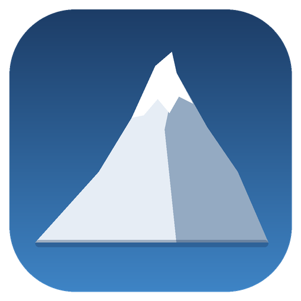

<!--
# SPDX-FileCopyrightText: Copyright 2025 Eden Emulator Project
# SPDX-License-Identifier: GPL-3.0-or-later

# SPDX-License-Identifier: GPL-2.0-or-later
-->

  

# Cervin

Cervin is an experimental, open-source Nintendo Switch and Switch 2 emulator written in C++. It
takes [Fritchii](https://github.com/Frizti/Fritchii) v6.5 as its base and adds the NVIDIA RTX and
Ryzen performance work of [Trudy](https://github.com/joshpack/Trudy) and the Mario Kart World fixes
of [Eglantine](https://github.com/Eglantine-Community/Eglantine). Cervin is not affiliated with
Nintendo.

Cervin is a modified version of GPL-licensed software: see [LICENSE.txt](LICENSE.txt) and the
copyright notices in the source files. It is an independent fork and is not Fritchii, Trudy or
Eglantine: please do not report Cervin problems to those projects (or to Lichii, Orchid or Eden).

## Where it comes from

| Source | What Cervin takes |
| --- | --- |
| Fritchii v6.5 (Frizti; fork of Lichii) | The base: everything in Fritchii v6.5 |
| Trudy (joshpack; fork of Orchid) | RTX 40/50 and Ryzen tuning, copying back only the GPU-written pages the CPU reads, Switch 2 performance defaults |
| Eglantine (Eglantine community) | Mario Kart World fixes Fritchii does not have yet |

All of them descend from Eden, yuzu and Sudachi.

## Only in Cervin

- **Saves from another emulator** (Help > Saves > From another emulator): pick games and copy
  their saves into Cervin from Ryujinx or any yuzu-family emulator (yuzu, suyu, Sudachi, Citron,
  Eden, Trudy, Lichii, Eglantine, Orchid), installed or portable. Each game shows the date of
  both saves; games whose save in Cervin is newer start unticked. The other emulator is only
  read, and Cervin's saves are backed up before any change.
- **French interface**, picked from the system language.

## Setup

On Windows, extract the whole build and run **lichii.exe** (the internal executable name is kept).
Only use games and system files you have legally obtained; games, keys and firmware are not
included.

- User data lives in `%APPDATA%\fritchii`, shared with Fritchii.
- The in-app updater is off: Cervin has no release channel of its own yet.
- Fritchii's shader precompile **recipes** (`*.nx2recipe`) are not part of Cervin. They are
  Frizti's, all rights reserved, and need Frizti's direct permission to ship in another build (see
  [LICENSES/Fritchii-Recipe.txt](LICENSES/Fritchii-Recipe.txt)).

## Building

See the [build guide](docs/Build.md). Windows needs Visual Studio 2022 Build Tools (Desktop
development with C++), Qt 6.8.3 (msvc2022_64 with qtcharts) and the Vulkan SDK 1.4.341.1. The GUI
target is still called `yuzu` and builds `lichii.exe`.

Branding-only commits carry the trailer `Cervin-Branding: yes`, so fixes can be cherry-picked
without them.

## Artwork

The Cervin logo, a small mountain (`dist/cervin.svg`, `dist/cervin.png`, `dist/cervin.ico`), is
generated by simple shapes.

## Credits and license

Cervin is a modified version of GPL-licensed software. The original copyright notices and
third-party licenses are kept in the source files; see [LICENSE.txt](LICENSE.txt).

- Base: Fritchii by Frizti, itself built on Lichii (zortos293), Eglantine, Eden, yuzu and Sudachi.
- Shader precompile system by Frizti (Fritchii). Modified in Cervin; see
  [LICENSES/Fritchii-Additional-Terms.txt](LICENSES/Fritchii-Additional-Terms.txt).
- Performance work from Trudy by joshpack, on top of Orchid by MythosOfs.
- Mario Kart World fixes from the Eglantine contributors.
- Dynamic FPS by Dark, bundled with his permission.
